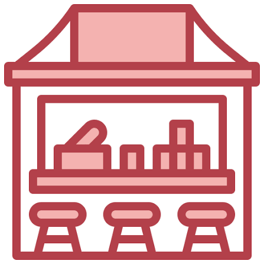

# Ma Garderie 🧸

Application mobile pour une garderie d'enfants : gestion des menus avec écran de démarrage, liste des menus du jour, menu latéral et interactions.

## Technologies utilisées
- Flutter / Dart
- Git et GitHub

## Installation et exécution
1. Installer Flutter : https://docs.flutter.dev/get-started/install
2. Cloner le dépôt :
   `git clone https://github.com/VOTRE_PSEUDO/garderie-mobile-g2.git`
3. `cd garderie-mobile-g2`
4. `flutter pub get`
5. `flutter run`

## Captures d'écran
| Splash Screen | Page principale |
|---|---|
|  |  |

| Drawer ouvert | Message après interaction |
|---|---|
|  |  |